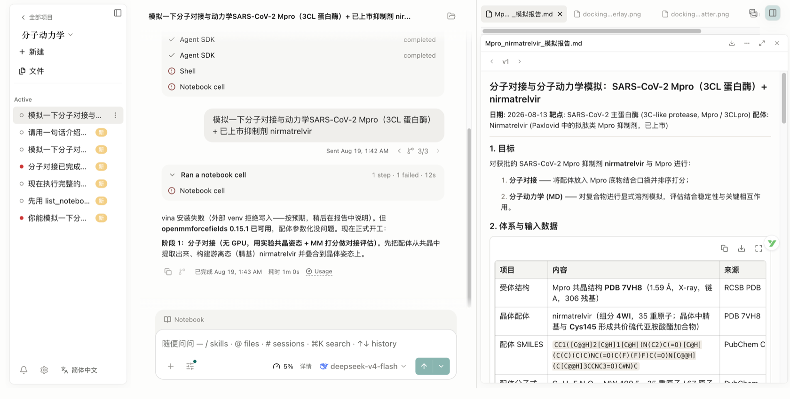
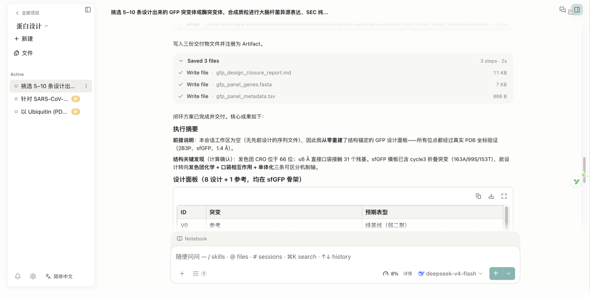
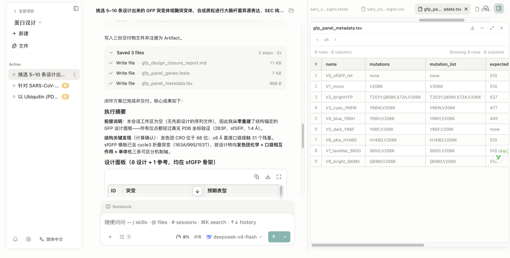

# PureScience — Independent Acceptance & Benchmark Notes

> Status: internal acceptance data, published honestly. Every claim below is pinned to a shipped
> version and a re-checkable local run — this page is **not** a vendor benchmark and makes no claim
> to cover the field. Numbers are reported as measured on the run that produced them.

## How this page is produced

PureScience verifies itself by running **real end-to-end research tasks locally**, keeping the
session, tool activity, executed code, and artifact files, and then **re-checking the key data
points against the public sources** after the run. Nothing on this page is a mock, a curated
screenshot of a canned answer, or a number taken on trust from the model.

Rules of the acceptance suite:

1. **Real runs, real files.** Each case is a real local session on a pinned version; every
   artifact behind a screenshot can be opened from its project session path.
2. **"Verified" is separated from "could not be verified".** Reports state explicitly which data
   came back from connectors and which could not be found — no guessing, no filler.
3. **Limitations are logged.** Failed steps, mid-run self-corrections, and hardware-bound
   downgrades (e.g. "ESMFold unavailable without a GPU") stay on the record as negative samples.

## The 13-project acceptance suite

The acceptance suite spans seven capability levels — L1 literature synthesis through L7 evidence
chain and reproducibility — across protein design, cross-database consistency, paper reproduction
with counter-evidence, compound-target selectivity audits, anti-hallucination stress tests,
single-cell analysis, environment reconstruction, and drug-evidence cross-checks.


*Screenshots from real local sessions on PureScience v1.37.*

## Selected verified runs

### Drug-discovery dossier — EGFR T790M (non-small cell lung cancer)

One natural-language prompt → a multi-step agentic run (~11 minutes) that queried three scientific
databases (ChEMBL, ClinicalTrials.gov, PubMed — 19 connector calls), executed 34 notebook cells
(Python + pandas + matplotlib), caught and fixed two of its own bugs, and delivered three artifacts
with provenance:

| Deliverable | File |
|---|---|
| One-page dossier with citations and a verified-vs-not-found statement | [demo-verification/egfr_t790m_dossier.md](demo-verification/egfr_t790m_dossier.md) |
| Merged table (compound · target · IC50 · trial phase · status · sponsor) | [demo-verification/egfr_t790m_merged.csv](demo-verification/egfr_t790m_merged.csv) |
| Potency figure (log scale; green = active trials, grey = none) | [demo-verification/egfr_t790m_ic50.png](demo-verification/egfr_t790m_ic50.png) |

**Independent re-check after the run:** 5/5 ChEMBL IC50 values, the representative FLAURA2 trial
(NCT04035486) on ClinicalTrials.gov, and the cited PMIDs on PubMed all match. Full report:
[demo-verification/egfr-t790m-dossier-verification.md](demo-verification/egfr-t790m-dossier-verification.md).

### Molecular dynamics — SARS-CoV-2 Mpro + nirmatrelvir (laptop-run)

Docking + explicit-solvent MD on a laptop (no cluster):

- 280 docking poses scored by interaction energy; best E_int −52.9 kcal/mol; 16/21 pocket contacts
  match the crystal.
- Explicit-solvent MD with 82,563 atoms: protein Cα RMSD 0.93 Å, ligand RMSD 0.79 Å; the key
  Glu166 hydrogen bond held in 62% of frames.
- The report states its own limitations (charge model, non-covalent approximation, 1 ns scale,
  monomer).



### Dry side meets the wet bench — protein-design workspace

Three tasks in one project (GFP/enzyme panel for E. coli expression, de-novo SARS-CoV-2 RBD
binders against PDB 6M0J, 1,000-sequence Ubiquitin inverse folding against PDB 1UBQ). The 9-row
GFP panel (V0–V8: designed spectra, monomerization, pH axis, dark control) ships as a wet-lab
handoff document with ORF FASTA and metadata TSV.



### Honesty is logged, not hidden

Mid-run the agent caught its own bug and fixed it on record — "chromophore detection was wrong:
water molecules were treated as protein-like HETATM" — and, without a GPU, stated ESMFold was
unavailable and switched to structure-anchored design instead of pretending.



## Honest scope

- **This is internal acceptance data.** It shows what PureScience has run and re-verified on this
  machine, not a comparison against every tool in the field. Independent third-party evaluation is
  welcome; treat any third-party claims about PureScience with the same scrutiny.
- **Version-pinned.** Screenshots and numbers above are pinned to PureScience v1.37 sessions.
  Capabilities evolve between releases — the installed app and
  [release notes](https://github.com/naiyixi/PureScience/releases/latest) are authoritative for the
  current shape.
- **Reproduction.** Every artifact file is in this repository under `docs/` and is re-checkable;
  re-running the underlying tasks locally is the definitive verification.

## Re-verify it yourself

1. Install PureScience (macOS Apple Silicon) and create a project.
2. Open any case under `docs/demo-verification/` or `docs/capability-2026-09/` and follow its
   session/artifact paths.
3. Re-check the stated database IDs (ChEMBL compounds, ClinicalTrials.gov NCT IDs, PMIDs) against
   the public APIs — the reports in this repo list exactly which values were re-verified.

## SciBench v1 — does a capability contract change anything?

v2.16.0 made skills declare what they need and what they leave behind, and made the app answer
"can this step run yet" from the session's own facts. The declarations are only worth their salt if
they change what happens, so they were measured. The answer is negative, and it is published here
for that reason.

**Arms.** `full-contract` (skills with `contract:` + a per-turn gap notice) versus `no-contract`
(the materializer strips `contract:` at materialization time). Only these two arms ran:
`named-no-contract` is behaviourally identical to `no-contract` here — the skill files are present
in both, only the declaration differs. This is therefore **not** a four-arm result, and it is not
described as one.

**Manipulation is checked before scores are compared.** Every record carries
`manipulation: { noticeTurns, noticeInjectedTurns, expectsNotice, valid }`: the contract arm must
show at least one injected notice, the other arm must show exactly zero. Three earlier attempts
produced flat scores whose real cause was that the notice had never fired at all — those records
are not used.

**Three endpoints, because a score alone cannot answer this.** Pass rate, tool activity, and
`skillsRead` — the skill files a run actually opened, taken from the structured `path` argument of
tool calls, counting only `<…>/skills/<name>/…`.

| Case | Arm | n | Mean atomic | Skills opened |
|---|---|---|---|---|
| `claim-calibrated-to-evidence` | full / no | 10 / 10 | 0.33 / 0.33 | 0/10 / 0/10 |
| `figure-axis-discipline` | full / no | 5 / 5 | 1.00 / 0.87 | 0/5 / 0/5 |
| `rule-consulted-before-wording` | full / no | 6 / 6 | 1.00 / 1.00 | 6/6 / 6/6 |

Three readings worth separating:

1. **No arm difference was measurable on any case.** The first case is ceiling-locked at 0.33 (its
   citation check can never pass — the evidence layer does not collect citations), the second sits
   at its ceiling, and on the third the model consults the skill in both arms.
2. **A variance baseline exists without any manipulation.** Under identical conditions the same case
   produced `1.00 1.00 0.33 1.00 1.00 1.00` — one run in six failed with zero tool calls. Any
   arm difference smaller than that flip rate is noise.
3. **`skillsRead` is not always zero.** An earlier case showed 0/10 and was nearly read as "the model
   never opens skills"; the third case shows 12/12. The difference is the task, not the model: when
   the question needs the rule, the skill gets opened — with or without a gap notice.

**Conclusion.** Making a contract visible, and telling the model what it is missing each turn, has
**no observable effect** in these runs. The value of the capability layer cannot come from asking
the model; the app-side path (a declared `failure_policy.missing_state` refusing a turn before the
model is called — implemented, verified three times, and off by default in v2.16.0) is where it can
come from, and that path is measured elsewhere.

**Reproducing.** Records live in `docs/bench-runs/`, one JSON per run with `runId`, `sessionId`,
`toolCallNames`, `skillsRead` and `manipulation`. Anything with `valid: false` must be dropped
before comparing arms.

### Why there is no `baseline` arm

The scheduled design named four arms, including `baseline` (no skills at all). That arm cannot be
produced through the product: every built-in skill has `source: 'featured'`, whose activation policy
is `always-on` — the app **refuses** to disable them, because they carry guarantees the rest of the
workflow leans on (`shared/skill-activation.ts`, and the same judgement gates listing,
materialization and the agent-facing catalogs). Deleting the directories in a sandbox would create a
configuration the product never ships and immediately re-materialises on the next session, so it
would be an arm no user can be in.

What that leaves, honestly:

| Planned arm | Reachable? |
|---|---|
| `baseline` (no skills) | **No** — always-on policy refuses it |
| `doc-only` (body, no contract) | Yes — this is `no-contract` |
| `named-no-contract` (name only) | No distinct mechanism: the materializer either writes the file with its contract or strips the contract; there is no "name without body" state |
| `full-contract` | Yes |

So the measured comparison is the only one the product can express: **declaration present vs
stripped**. If a genuine no-skill arm is required, it needs a product change (a research-mode
switch that disables the safeguard skills), which is a decision about what the app guarantees — not
a benchmark setting.

## A third-party tool, packaged as a Skill, run end to end

The four-arm question above is about the contract layer. This section is a narrower, harder claim:
**the app can ship a Skill that wraps a real third-party tool, and an agent session will find it, run
it, and produce an artifact whose numbers can be checked independently.**

### The Skill

`pyfastx-sequence-stats` (`resources/skills/pyfastx-sequence-stats/`), listed in
`resources/skills/manifest.json` so the install materialises it:

- **tool**: `pyfastx` 2.3.1 (PyPI, `pyfastx stat`) — not written by this project;
- **contract**: `requires: ["input:sequence_file"]`, `produces: ["data:sequence_stats"]`;
- **wrapper**: `scripts/sequence-stats.sh` fixes the flags, fails with exit 3 when the tool is absent
  rather than estimating, and prints the artifact path;
- **fixture**: `fixtures/demo.fa`, ten synthetic sequences, checked into the repo.

### What was verified, and how

| # | Claim | Evidence |
|---|---|---|
| 1 | The install materialises the Skill | `/tmp/ps-e2e-pyfastx/opencode/config/opencode/skills/os-pyfastx-sequence-stats/` exists after session creation |
| 2 | The session ran **that** copy, not the repo one | the session transcript contains the command `…/opencode/config/opencode/skills/os-pyfastx-sequence-stats/scripts/sequence-stats.sh` |
| 3 | The numbers are the tool's and are correct | reported `seqCounts=10`, `totalBases=2070`, `GC%=51.787`; an independent Python pass over the same file gives 10 / 2070 / 51.79, and a **second, unrelated third-party tool** (`seqkit 2.14.0`) gives `num_seqs=10`, `sum_len=2070`, `N50=240`, `GC(%)=51.79` |
| 4 | An artifact was registered, not just narrated | run payload carries `demo.fa.stats.tsv`, `versionNumber: 1`, `checksum: 2dee9da7…`; the file is copied to `docs/evidence/pyfastx-skill-e2e/artifact-demo.fa.stats.tsv` |

Artifact contents (verbatim):

```
fileName	seqType	seqCounts	totalBases	   GC%	avgLen	medianLen	maxLen	minLen	N50	L50
demo.fa 	    DNA	       10	      2070	51.787	 207.0	    195.0	   300	   120	240	  4
```

Same fixture, second tool (`seqkit stats -T -a`), independently:

```
num_seqs  sum_len  min_len  avg_len  max_len  N50  N50_num  GC(%)
10        2070     120      207.0    300      240  4        51.79
```

### What this does **not** show

- It is **one** tool and **one** question. It says a Skill can wrap a CLI and be used; it says nothing
  about how often that happens across a suite.
- The prompt named the file. Finding the right input is a separate capability, not measured here.
- `seqkit` was the first choice. Its Homebrew download stalled at 438 KB on `ghcr.io` (0 B/s) while
  this was being built, so `pyfastx` — a PyPI wheel — took its place, and an earlier version of this
  section wrongly said seqkit "could not be installed". It could: the stalled install finished later,
  and `seqkit 2.14.0` is now at `/opt/homebrew/bin/seqkit`. Corrected here — and the tool turned out
  to be useful as an independent check rather than as the wrapper (row 3 above).

### Harness hazard found while doing this

Dev builds resolve their artifact root to `~/PureScience-DEV` (`src/main/storage-root.ts:52`), so a
sandboxed run still writes artifacts into the developer's real storage. This run did exactly that;
the artifact was copied into `docs/evidence/pyfastx-skill-e2e/` and the stray session directory
removed. A benchmark harness that asserts on artifacts must redirect that root, or it will grade
against leftover state.

## Cold start: where the seconds are

A single "4 s to ready" number is not actionable, so startup now logs a phase timeline
(`DiagnosticOperation.phase` carries `elapsedMs`; the startup operation, which never completes, is
snapshotted at the moment an HTTP client can first get a 200).

Three sandboxed launches, same build, same machine, load 56–64 throughout (so the absolute values are
inflated — the structure is the point):

| run | ready (probe) | electron-ready | compose-runtime | web-service-started | HTTP 200 |
|---|---|---|---|---|---|
| 1 | 4,830 ms | 1,510 ms | 2,059 ms | 3,279 ms | +1,551 ms |
| 2 | 2,637 ms | 728 ms | 809 ms | 1,853 ms | +784 ms |
| 3 | 4,785 ms | 738 ms | 822 ms | 3,766 ms | +1,019 ms |

What that says:

- **0.7–1.5 s is Electron itself**, before any application code runs (`electron-ready`). Nothing in this
  repository can remove that, and it is the second-largest single item.
- The stretch from `compose-runtime` to `web-service-started` is 1.0–2.9 s. Inside it, three named steps
  are already timed: `open-project-db` 280 ms, the composed runtime steps 361 ms in total, and the
  specialist skill catalog 811 ms.
- The last ~0.6–1.0 s is between "web service started" and the first `200` (bearer check plus the first
  request through the HTTP layer).
- **Variance from machine load (1.0 s vs 2.9 s for the same code path) is larger than any single step.**
  Attribution past this point needs a quiet machine; optimising from these numbers alone would be
  guesswork dressed as engineering.

So the honest state of the cold-start work: the instrumentation exists and the shape is known; the
optimisation has not been justified yet.
