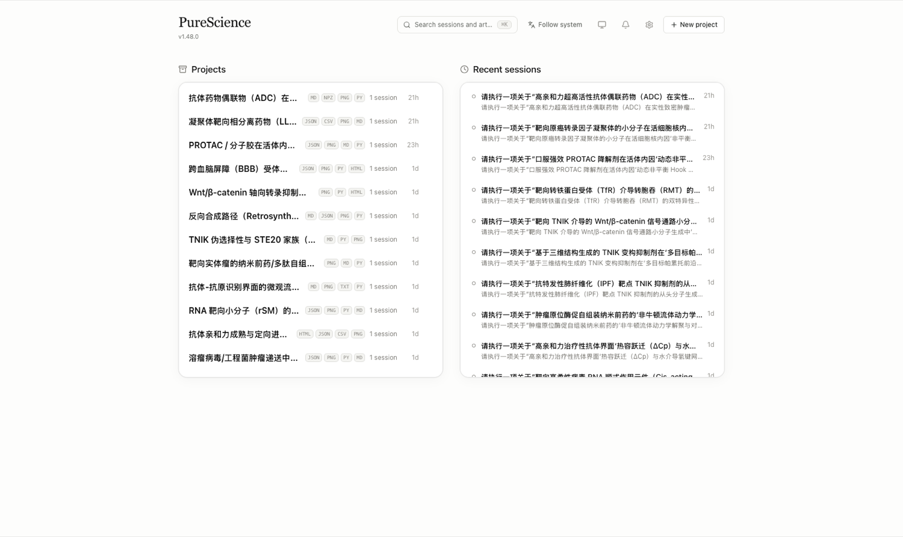

# 极端对抗压力测试（2026-09）

> 返回 [README](../../README.md)

Between 2026-09-04 and 2026-09-07, PureScience was handed **30 adversarial research challenges** by external reviewers — no demo data, no curated inputs. The reviewer spread them across five daily sessions, and the runs themselves finished in **~6 hours of total runtime on a single Apple M2 laptop with 8 GB of RAM**. Each challenge described a state-of-the-art but deeply flawed research claim (a kinase "selectivity" chemistry cannot support, an antibody whose affinity defeats its own brain delivery, a condensate drug that "dissolves" a transcription factory by gelling it, a CAR whose affinity can never compensate sparse antigen…) and demanded a mechanism-level verdict. Every run ended with a versioned deliverable set: a Chinese adjudication report (with its own Data-Gap list), the solver code, and publication-grade figures — visible in the project's Files panel and replayable from the conversation. Every wave also carries an external reviewer scorecard — see the [scoring archive](../extreme-tests-2026-09/SCORECARD.md).

The complete evidence is archived case-by-case: **all 30 reports, solvers, and figures live under [`docs/extreme-tests-2026-09/cases/`](../extreme-tests-2026-09/cases/)**, with an in-app session screenshot per flagship case in the [full evidence gallery](../extreme-tests-2026-09/README.md). Below is a condensed tour.

_The projects page after the marathon — every row lists the actual file types its session produced (MD · PY · PNG · CSV · HTML)._

  

*LLPS condensate-drug session — the conversation (left) includes the agent catching a coordinate mismatch in its own figure and re-rendering it; the Files panel (right) holds the versioned report, solver, figures and data.*

More sessions, same pattern — each with its own solver outputs in the Files panel:

  
  
  
  

Sampled verdicts — each row is a direct summary of a real session's report:

| Challenge area                            | The trap in the claim                                                            | What the run concluded                                                                                                                                                         |
| ----------------------------------------- | -------------------------------------------------------------------------------- | ------------------------------------------------------------------------------------------------------------------------------------------------------------------------------ |
| Kinase selectivity (TNIK vs its paralogs) | Hinge backbone H-bonds + a high docking score ⇒ "1,000× selective"               | Contact residues are 100% conserved between paralogs; the thermodynamic upper bound (≤1.5 kcal/mol) cannot encode a 1,000× difference                                          |
| BBB transcytosis (TfR bispecific)         | Higher affinity ⇒ more antibody reaches the brain                                | Off-rate half-life 9.6 h vs a ~3.3 min endosomal sorting window ⇒ ~92 % routed to lysosomal degradation; the working regime is 50–300 nM affinity with a pH-sensitive release  |
| Condensate-targeted drug (LLPS)           | Partition ratio > 300 into the condensate ⇒ dissolution of the oncogenic network | High partitioning deepens the thermodynamic well first: percolation/gelation (θc ≈ 0.28) happens long before any dissolution threshold — a physical sequestration trap for p53 |
| Single-cell trajectory (CD8 exhaustion)   | Trajectory endpoint = true terminal state                                        | Dissociation-stress cells are injected into the "terminal" branch (~48 % of it); gene-set filtering / regression restores terminal classification F1 from 0.52 to 0.96         |
| CAR-T killing at low antigen density      | Near-infinite affinity compensates sparse antigen                                | Below ~500 copies per cell the membrane cannot be pinned to exclude CD45 — signaling output stays ≈0 regardless of affinity                                                    |
| Synthetic ecology (engineered bacteria)   | A synchronized lysis circuit releases drug forever                               | Every lysis pulse amplifies non-lysis "cheater" mutants 20–50×; the clock stops within a few pulses (spatial structure delays, never prevents it)                              |

Every one of the 30 runs has its own archived case folder with the full report, solver and figures — see the [case index](../extreme-tests-2026-09/cases/) and per-case one-line verdicts (EN + 中文) in the [gallery](../extreme-tests-2026-09/README.md).

Every figure below is a real artifact produced by that session's own numerical solver (ODE / PDE / lattice Monte-Carlo) — not a stock graphic:

  

*LLPS condensate drug: Flory-Huggins phase diagram, curing heatmaps — Cahn–Hilliard phase-field solver.*

  

*BBB/TfR transcytosis: affinity × dose × brain-exposure phase diagram — the high-affinity plateau where delivery collapses.*

  

*ADC multiscale barrier: radial concentration contours around a vessel at 168 h — high-affinity arm pinned within 1–2 cell diameters.*

  

*TNIK vs paralog selectivity audit: P-loop conformational snapshots across crystal forms — the "1,000× selectivity" has no physical basis.*

  

*TPD futile-cycle model: degradation efficiency over ternary-complex lifetime × DUB activity — too-tight binding burns ATP and degrades nothing.*

  

*bNAb directed evolution: pairwise epistasis deviations — greedy mutation stacking loses ~10× affinity to negative epistasis.*

…and **24 more challenge figures** (RNA polyelectrolyte entropy, lyophilization water-percolation, CAR-T synapse phase diagrams, engineered-bacteria cheater sweeps, antibody ΔCₚ cold reversal, …) are archived with their reports and solver code in the [full evidence gallery](../extreme-tests-2026-09/README.md).

> **中文速览（2026-09 极限压测）**：30 道研发委员会级对抗性压测（激酶同源选择性 → 血脑屏障转胞吞 → 相分离凝胶化 → 免疫突触 → 演化博弈…）于 09-04 → 09-07 在一台 Apple M2 8GB 笔记本上完成 —— **合计计算 ≈6 小时，评审分 5 天逐批发出**；每题交付「中文裁决研报 + 数值求解器 + 出版级图件」，全部保留在会话 Files 面板、可版本回放；报告延续「Data Gap 清单」与「已验证 / 无法核实」分离口径。压测中系统还多次驳回出题方的诱导性前提（如「强表达必致混沌」被数值结论直接否定）。**全量证据已入库**：30 个案例文件夹（研报/代码/图件）见 [`docs/extreme-tests-2026-09/cases/`](../extreme-tests-2026-09/cases/)，带会话截图与逐题一句话裁决的完整图库见 [`docs/extreme-tests-2026-09/README.md`](../extreme-tests-2026-09/README.md)，**历轮评审打分**（外部评审 1–10 分/等级制原表）见 [`SCORECARD.md`](../extreme-tests-2026-09/SCORECARD.md)；实证介绍 PPT（含会话截图与产物图）随 Release 资产与演示素材提供。
