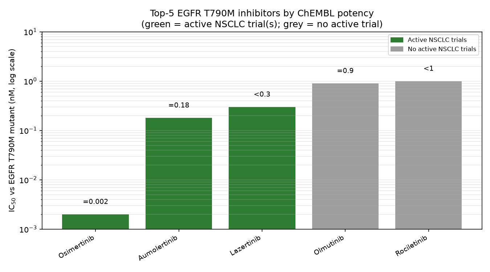

# Showcase

> Back to [README](../README.en.md)

One natural-language prompt → multi-step agentic research → **traceable, reproducible science**. The demo below ran end-to-end in ~11 minutes: the agent queried three scientific databases (ChEMBL, ClinicalTrials.gov, PubMed — 19 connector calls), executed 34 notebook cells (Python + pandas + matplotlib), caught and fixed two of its own bugs, and delivered three artifacts with provenance.



**The task (verbatim):**

```
Build a drug-discovery intelligence dossier for EGFR T790M (non-small cell lung cancer).

1. Use the ChEMBL connector to retrieve published small-molecule inhibitors of
   EGFR T790M (Homo sapiens, IC50 < 100 nM). Rank by potency, take the top 5.
2. Cross-reference those 5 compounds against ClinicalTrials.gov: which are in
   active clinical trials for NSCLC? Record trial phase, status, and sponsor.
3. Use PubMed to find up to 3 key papers per compound (mechanism / clinical evidence).
4. Write a Python script to merge everything into one table (compound, target,
   IC50, trial phase, status, sponsor) and generate a bar chart of IC50 values.
5. Deliver three artifacts: (a) the merged table as CSV, (b) the potency figure,
   (c) a one-page markdown dossier with citations. Explicitly state which data
   was verified via connectors and which could not be found.
```

**What it produced — every file real, every number independently verified:**

| Deliverable                                                              | File                                                                          |
| ------------------------------------------------------------------------ | ----------------------------------------------------------------------------- |
| One-page dossier with citations and a verified-vs-not-found statement    | [egfr_t790m_dossier.md](demo-verification/egfr_t790m_dossier.md)              |
| Merged table (compound · target · IC50 · trial phase · status · sponsor) | [egfr_t790m_merged.csv](demo-verification/egfr_t790m_merged.csv)              |
| Potency figure (log scale; green = active trials, grey = none)           | [egfr_t790m_ic50.png](demo-verification/egfr_t790m_ic50.png)                  |
| In-app preview of the generated chart                                    | [shot4-figure-preview.png](demo-verification/assets/shot4-figure-preview.png) |

All key data points were re-checked against the public APIs after the run: 5/5 ChEMBL IC50 values, the representative FLAURA2 trial (NCT04035486) on ClinicalTrials.gov, and the cited PMIDs on PubMed all match. The agent also disclosed its own limits in the dossier — records it could not resolve, connector pagination constraints, and compounds with no active trials — instead of guessing. Full details: [demo verification report](demo-verification/egfr-t790m-dossier-verification.md).

<p align="center">
  
</p>
